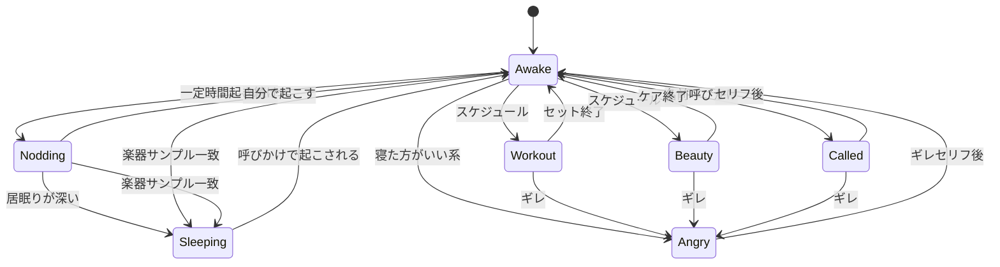

# 堀大輔ルーム

ブラウザを開いたらすぐ一部屋。トモコレの部屋のように、家具のある室内に堀大輔がいる。ログイン・ロビー・他キャラ・複数部屋は出さない。

コアギャグ: ショートスリーパーと言い張るが、実際は居眠りする。起きてるそぶりを崩した瞬間が面白い。性格・口癖は [character.md](./character.md)。

私的プロトタイプ。マイク音声が主、クリックは補助（許可拒否時・デバッグ含む）。脳はステートマシン＋固定セリフ。LLMなし。

## 部屋

固定カメラ。初期はオービットしない（デバッグで後から足してよい）。

筋トレグッズと美容ケア道具が目に入る配置。キャラは床に立つ。部屋に対してトモコレ寄りに大きめ。

## ステート

- **Awake**: 起きてるアピール。瞬き・ストレッチ。「寝てないが？」系の独り言。
- **Nodding**: 頭が落ちてパッと起き直す。メインの笑い。起き直すときも「寝てないが？」。
- **Called**: 「堀大輔」「大輔」「ホリ」で短い返事。部分認識でもヒット。
- **Angry**: 「寝た方がいいんじゃないですか？」および 寝ろ / 寝た方がいい / 睡眠不足。固定セリフ＋怒りモーション。この間は呼びかけ無視可。
- **Workout**: 定期筋トレ。声かけには短く返すか「今セット中」。ギレはセットを切って即 Angry。
- **Beauty**: スキンケア等。Workout と同じ割り込み方針。
- **Sleeping**: 楽器サンプル一致で強制遷移。起きてるそぶり終了。呼びかけで起こし、「寝てないが？」で Awake。

スケジュールは壁時計ではなくページを開いてからの経過時間。初期値（実装時に調整してよい）:

- 居眠り兆候（Awake → Nodding）: 約 10 秒起き続け
- Nodding が深い → Sleeping: 約 10 秒（合わせて爆睡まで約 20 秒）
- Workout: 約 3 分おき、1 セット約 20 秒
- Beauty: 約 5 分おき、約 15 秒
- Workout と Beauty が重なったら Workout 優先
- Angry / Called 中はスケジュール遷移しない。Sleeping 中も筋トレ・美容は入らない

優先度（同時に条件が揃ったとき）: 楽器マッチ > Angry > Called > スケジュール行動 > Nodding。

## 音声

入場時にマイク許可。拒否なら「マイクなしでもデバッグボタンで同等操作」と出す。

入力:

- **呼びかけ**: Web Speech API 連続認識。部分結果でも名前ヒットで Called。起こしにも同じ名前ヒットを使う。
- **ギレ**: 認識テキストのキーワード照合。完全一致にしない。
- **楽器眠り**: 設定で参照音を1回録音し、IndexedDB（大きければ）または localStorage に保持。以降は Web Audio で入力とサンプルのスペクトル類似度が閾値超えなら Sleeping。合言葉では寝かせない。
- **起こす**:眠っている時に大きな音を出すとぱって起きる。その後寝てないが？と言う。
- **デバッグ**: Called / Angry / Nodding / Sleeping / Workout / Beauty をボタンで強制遷移。

出力（喋り）: 固定セリフは合成音声とテキストを同時に出す。トモコレ同様、頭上（または口元）の吹き出しに全文を出す。音声が失敗・ミュートでも吹き出しだけで内容が分かる。吹き出しは発話中だけ出し、終わったら消す。

目指すのはトモコレの「高い・短い・モーラで跳ねる」感じ。任天堂の音声エンジンの再現はしない（工数と IP）。

V1 は `speechSynthesis`（日本語ボイス）の出力を Web Audio に通し、ピッチを上げ、少し速くし、文節ごとにピッチを振る。Angry はさらに高く速く、Sleeping 起こしはぼんやり遅め、くらいステートで変える。これでギャグとしては足りる。自然な美声 TTS は逆にトモコレ感が死ぬので使わない。

足りなければ Voicevox 等のキャラボイスに差し替える（別プロセスが要る）。初期はブラウザ内だけで完結させる。

対象ブラウザは Chromium 系。Safari は初期対象外（Web Speech）。

## 3D

ソースはボーン済み Blender FBX。`FBX → GLB` して `public/models/` に置く。

クリップ: `idle`, `walk`, `strut`, `sleep`, `nodding`, `workout`, `angry`, `beauty`, `called`。`awake` は Sleeping→Awake の起き上がり（一回）。`nodOff` / `snapAwake` は未実装。

描画は React + Three.js。実体は Vite + React + TypeScript + `@react-three/fiber` + `@react-three/drei` + `three`。バックエンドなし。

## 初期にやらないこと

LLM会話、複数部屋、マルチプレイ、配信オーバーレイ、モバイル最適化、物理演算、口パクの精度、独自サーバ、トモコレ音声の複製、Voicevox 必須化。

## できたと言える条件

1. URLを開くと部屋と堀大輔が見える
2. 名前を呼ぶと吹き出し＋合成音声で反応する
3. 「寝た方がいいんじゃないですか？」でギレ声になり、同じセリフがテキストでも出る
4. 録音した楽器音で眠り、呼びかけで「寝てないが？」と吹き出し＋声で起きる
5. 放置すると筋トレか美容ケアに入り、居眠り兆候も出る
