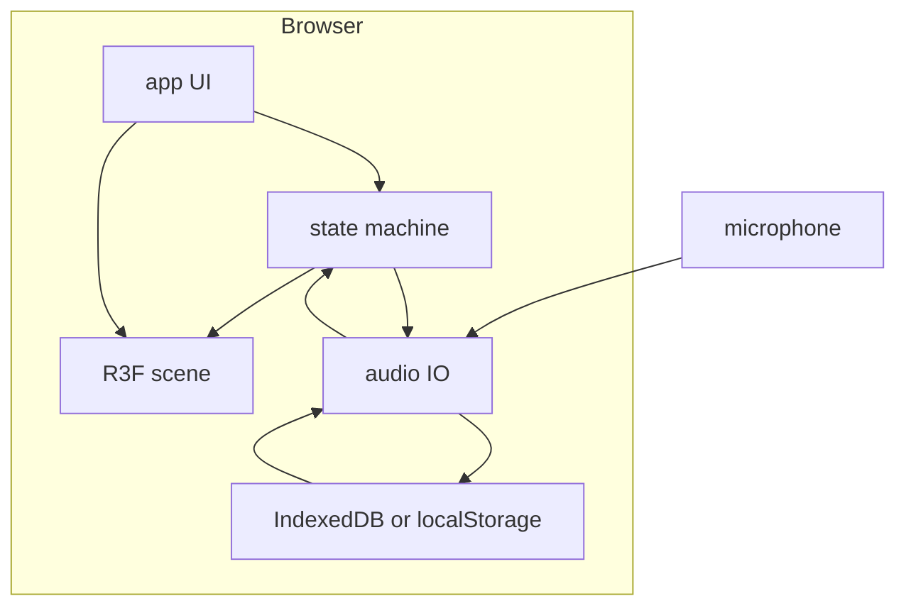
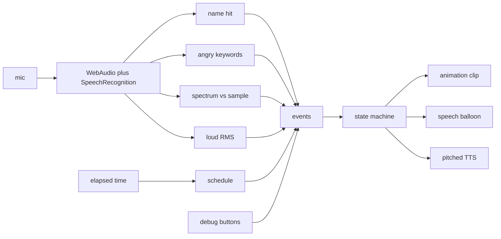

# 技術設計（V1）

仕様の正は [idea.md](./idea.md)。ブラウザ単体 SPA の実装境界とパイプライン。サーバ・LLM なし。Chromium（Web Speech）。静的配信。スコープ外は idea の「初期にやらないこと」。

## 構成



| 層 | 技術 |
|---|---|
| ビルド / UI | Vite, React, TypeScript |
| 3D | `three`, `@react-three/fiber`, `@react-three/drei` |
| 認識 | Web Speech API（連続、部分結果） |
| 発話 | `speechSynthesis` → Web Audio（ピッチ・速度） |
| 楽器マッチ / 起こし音量 | Web Audio（AnalyserNode） |
| 参照音 | IndexedDB（大きいとき）。小さければ localStorage |

## ディレクトリ（実装時）

```
src/
  app/       # マイク許可、拒否時メッセージ、デバッグ強制遷移
  scene/     # 部屋・キャラ・カメラ・吹き出し
  machine/   # 単一ステート、優先度、経過時間スケジュール
  audio/     # STT、キーワード、スペクトル類似、RMS起こし、TTS
  persist/   # 参照音の読み書き
public/models/  # GLB
```

`machine` は DOM / Three / Web Audio に依存しない。音声はイベントだけ上げ、遷移結果を購読する。

## データフロー

スケジュール時計は `performance.now()`（ページ開始からの経過）。遷移図・優先度・タイマー初期値は idea。同時条件は優先度で **1遷移だけ**。



## 音声

`getUserMedia` を入場時に取る。拒否時はデバッグボタンで同等操作。認識と Analyser は同じストリームを共有する。名前・ギレ語の文字列は idea。

| イベント | 判定 | 使い方 |
|---|---|---|
| 呼びかけ / 起こし（名前） | 連続認識の **部分結果** でもヒット | Called。Sleeping 中は Awake |
| ギレ | 認識テキストの部分一致。完全一致にしない | Angry |
| 楽器眠り | 設定で1回録音した参照音と入力のスペクトル類似度が閾値超え | Sleeping。**合言葉では寝かせない** |
| 起こし（大きな音） | Sleeping 中の入力 RMS が閾値超え | Awake（名前ヒットと同じ起き処理） |

idea のステート図は起こしが呼びかけだけ。実装は名前 **または** 大音量のどちらでも Awake。

TTS は `speechSynthesis`（日本語）を Web Audio に通す。ピッチ・速度のステート差は idea。失敗・ミュートでも吹き出しに全文、発話中だけ表示。Voicevox は V1 に入れない（別プロセスが要る後続）。

## 3D

ボーン済み Mixamo FBX を `scripts/pack_hori_glb.py` で GLB にまとめ `public/models/` へ。クリップ: `idle`, `walk`, `strut`, `sleep`, `nodding`, `workout`, `angry`, `beauty`, `called`。`awake` は Sleeping→Awake の起き上がり。カメラ・部屋は idea（固定、初期オービットなし）。
